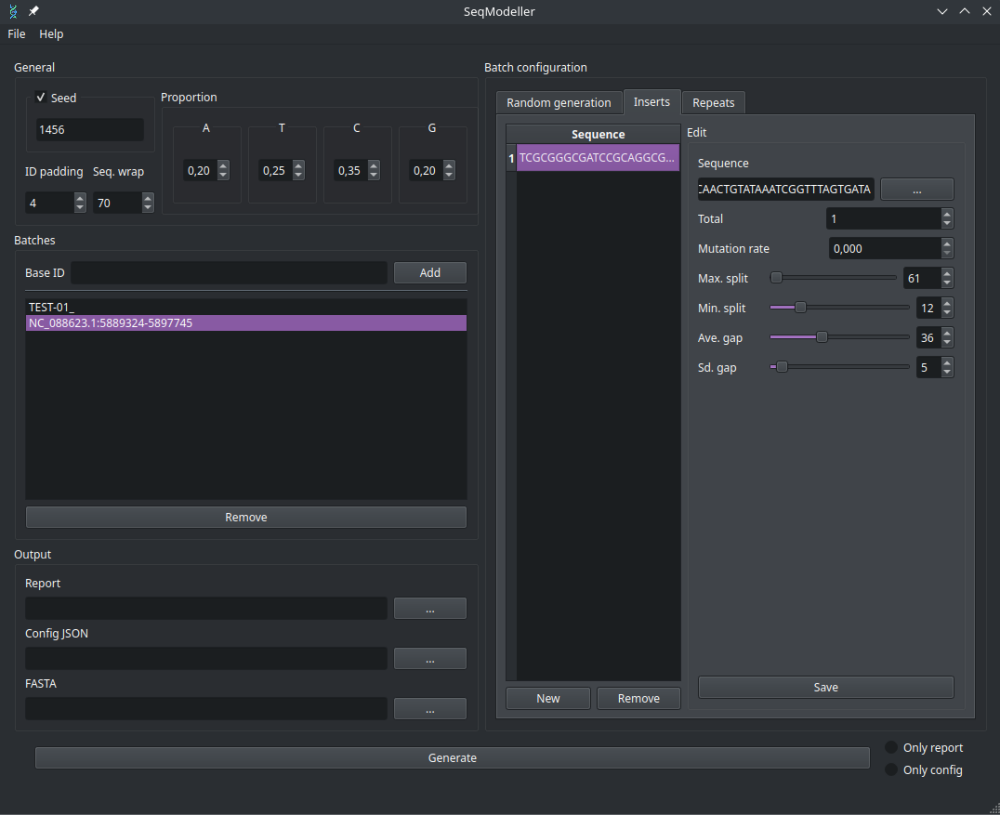

# SeqModeller


A PyQt6 desktop application for generating synthetic DNA, RNA and protein
sequences. SeqModeller is a GUI frontend for the
[fastaModeller](https://pypi.org/project/fastamodeller/) command line tool.



## Features

- **DNA, RNA and protein** alphabets, including IUPAC ambiguity symbols.
- **Per-batch composition** with relative weights, uniform/normalize helpers and
  add/remove symbol controls.
- Randomized sequence batches with configurable length ranges and counts.
- Tandem **repeat patterns** with likelihood and min/max repetition counts.
- **Inserts** with split points, normally distributed gaps and per-residue
  mutation rates.
- **Validation** both in the GUI and through the external
  `fastamodeller validate` command.
- Generate **FASTA**, a detailed **report** and a reproducible **config JSON**
  in any combination.
- Random or explicit **seeds**; the resolved seed is stored in the exported
  configuration.
- **Background generation** with a progress dialog and cancellation.
- Recent files, associated output paths, last used directory and unsaved-change
  protection.
- Import and migration of configurations created by older SeqModeller versions.

## Requirements

- Python 3.10 or newer.
- `PyQt6`.
- The `fastamodeller` command line tool. The pinned version is `1.0.0`.

## Installation

### Conda environment (recommended)

```bash
conda env create -f environment.yml
conda activate seqmodeller
python main.py
```

### pip / virtualenv

```bash
python -m venv .venv
source .venv/bin/activate
python -m pip install --upgrade pip
python -m pip install -e ".[dev]"
python main.py
```

`fastamodeller` is installed as a Python dependency. SeqModeller looks for the
`fastamodeller` (or legacy `fastaModeller`) executable in `PATH`, then falls
back to `python -m fastamodeller`. You can override the command with the
`FASTAMODELLER_BIN` environment variable.

### Compiled binary

The Nuitka build includes the `fastamodeller` package and a small internal CLI
launcher (`--fastamodeller`), so the executable stays self-contained. Rebuild
with:

```bash
python dev/deploy.py --config dev/deploy.json --verbose
```

## Quick start

1. Select the **molecule** (DNA, RNA or protein).
2. Enter a **Base ID** and click **Add** to create a batch.
3. Configure the sequence count and length range.
4. Edit the batch **Composition** tab.
5. Optionally add repeat patterns and inserts.
6. Select one or more output files.
7. Click **Generate**.

The application validates the configuration with the GUI rules and with
`fastamodeller validate` before starting the external process.

## Configuration format

SeqModeller reads and writes the `fastamodeller` JSON schema:

```json
{
    "molecule": "dna",
    "id_padding": 4,
    "seq_wrap": 70,
    "seed": 12345,
    "sequences": [
        {
            "base_id": "TEST",
            "generate": 10,
            "min_len": 500,
            "max_len": 1000,
            "proportion": {
                "A": 0.20,
                "T": 0.25,
                "C": 0.20,
                "G": 0.35
            },
            "repeats": [
                {
                    "likelihood": 0.5,
                    "pattern": "ATCATT",
                    "pattern_min_reps": 10,
                    "pattern_max_reps": 50
                }
            ],
            "inserts": [
                {
                    "total": 4,
                    "min_split": 0,
                    "max_split": 5,
                    "ave_gap": 5,
                    "sd_gap": 2,
                    "mutation_rate": 0.05,
                    "sequence": "CCCCCCTTAAACACTTATACGGTAG"
                }
            ]
        }
    ]
}
```

Notes:

- `proportion` values are relative weights; `fastamodeller` normalizes them.
- `seq_wrap: false` or `0` disables line wrapping.
- `seed: false` selects a random seed. The resolved seed is written to the
  report and to the exported configuration.
- Only one molecule can be used per configuration.
- Old configurations without `molecule`, `seq_wrap` or `seed` are migrated
  automatically when opened.

## Output files

- **FASTA**: generated sequences.
- **Report**: seed, composition, GC content, ambiguous fraction, insert
  mutations/gaps and repeat counts.
- **Config JSON**: normalized configuration, including the resolved seed.

Files are written atomically by the `fastamodeller` CLI and by the GUI config
writer.

## Architecture

```text
main.py                       # entry point
seqmodeller/
  app.py                      # QApplication and internal CLI launcher
  paths.py                    # resources, version, app data directory
  domain/
    molecules.py              # DNA/RNA/protein alphabets
    models.py                 # AppState, batches, inserts, repeats
    validation.py             # pure validation rules
    serialization.py          # JSON <-> state conversion and migration
  services/
    generator.py              # Generator protocol and DTOs
    fastamodeller_cli.py      # subprocess adapter for the CLI
    files.py                  # atomic writes and path helpers
    session.py                # recent files and last directory
  ui/
    main_window.py            # presentation and wiring
    models.py                 # Qt list/table models
    widgets.py                # slider/spinbox sync, weight delegate
    dialogs.py                # About and insert dialogs
  resources/                  # .ui files, images, version and template
tests/                        # domain, service and UI tests
```

The UI depends on the `Generator` protocol, not on `subprocess` or on the
`fastamodeller` internals. The CLI is the only generation boundary, which keeps
the presentation and engine responsibilities separate.

## Development

```bash
python -m pytest
python -m ruff check seqmodeller tests main.py dev/update_version.py
python -m mypy seqmodeller
```

Version references are synchronized from
`seqmodeller/resources/version.json`:

```bash
python dev/update_version.py
```

## License

This project is licensed under the MIT License. See `LICENSE.txt`.
